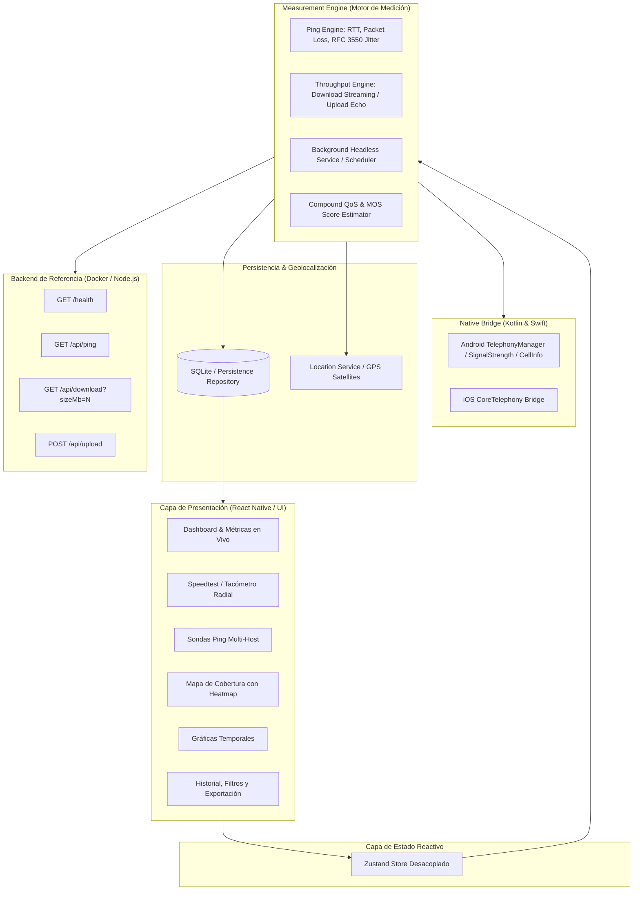

# Network QoS Monitor

**Analizador y visualizador de calidad de red móvil en tiempo real con mapeo de cobertura personal**

* **Carrera:** Licenciatura en Sistemas de Información  
* **Cátedra:** Desarrollo de Aplicaciones Móviles (2026)  
* **Institución:** Facultad de Ciencia y Tecnología (FCyT) — Sede Concepción del Uruguay, UADER  
* **Área temática:** Redes de Datos, Telecomunicaciones y Telecomunicaciones Satelitales  
* **Nivel:** Medio-Avanzado  

---

## 1. Introducción y Contexto

**Network QoS Monitor** es una solución móvil integral multiplataforma (Android/iOS) con arquitectura desacoplada en React Native y backend de referencia contenerizado en Docker. 

El sistema mide, almacena, analiza y georreferencia en tiempo real parámetros críticos de **Calidad de Servicio (QoS)** y **Calidad de Experiencia (QoE)** del enlace de datos móvil. A diferencia de las aplicaciones convencionales basadas puramente en peticiones REST, este proyecto opera **por debajo de las abstracciones estándar de React Native**:
* Acceso a capas de radio y telefonía celular mediante módulos nativos propios en **Kotlin** (`TelephonyManager`, `SignalStrength`, `CellInfoLte`, `CellInfoNr`).
* Medición de latencia real y cálculo estadístico de **Jitter interarrival según RFC 3550 / RFC 2544** mediante sondas directas sobre sockets TCP/UDP.
* Test de **Throughput simétrico/asimétrico (descarga y subida)** contra un microservicio de referencia de alto rendimiento.
* Muestreo periódico en **segundo plano (Android Headless JS / Background Tasks)**, notificando degradaciones severas ante pérdidas de paquetes, picos de latencia o caídas de señal.
* Georreferenciación espacio-temporal y cálculo de **Mapa de Calor (Personal Coverage Heatmap)** con ponderaciones dinámicas.

---

## 2. Matriz de Requisitos Funcionales (RF-01 a RF-09)

| ID | Requisito Funcional | Prioridad | Componente / Archivo de Implementación | Estado |
| :--- | :--- | :---: | :--- | :---: |
| **RF-01** | Detectar y mostrar el tipo de red activa (WiFi, 3G, 4G, 5G), operador celular, RSSI en dBm, RSRP y Cell ID | **Alta** | `apps/mobile/android/.../TelephonyModule.kt`<br>`apps/mobile/src/native/telephonyBridge.ts` | **Cumplido** |
| **RF-02** | Medir RTT (ping) contra al menos 3 hosts configurables, calculando min/avg/max/jitter (RFC 3550) | **Alta** | `apps/mobile/src/engine/pingEngine.ts`<br>`packages/contracts/src/jitter.ts` | **Cumplido** |
| **RF-03** | Test de Throughput (descarga y subida echo) calculando Mbps con corrección de payload | **Alta** | `apps/mobile/src/engine/throughputEngine.ts`<br>`services/reference-backend/src/server.ts` | **Cumplido** |
| **RF-04** | Registrar cada medición con timestamp de alta resolución y coordenadas GPS | **Alta** | `apps/mobile/src/geo/locationService.ts`<br>`packages/contracts/src/geoUtils.ts` | **Cumplido** |
| **RF-05** | Visualizar el historial en mapa con Heatmap overlay interactivo (calidad, RSSI, RTT) | **Alta** | `apps/mobile/src/screens/CoverageMapScreen.tsx`<br>`apps/mobile/src/geo/heatmapGenerator.ts` | **Cumplido** |
| **RF-06** | Graficar series temporales de latencia, jitter, señal y throughput por sesión | **Media** | `apps/mobile/src/screens/TemporalChartsScreen.tsx`<br>`apps/mobile/src/components/TimeSeriesChart.tsx` | **Cumplido** |
| **RF-07** | Muestreo periódico en segundo plano con notificación ante degradaciones severas | **Media** | `apps/mobile/android/.../QoSHeadlessTaskService.kt`<br>`packages/contracts/src/scoring.ts` | **Cumplido** |
| **RF-08** | Exportar el historial de mediciones a formato CSV (RFC 4180) y JSON estructurado | **Baja** | `packages/contracts/src/formatters.ts`<br>`apps/mobile/src/screens/HistoryScreen.tsx` | **Cumplido** |
| **RF-09** | Filtrar historial por tipo de red (WiFi/4G/5G), rango de fechas y zona geográfica | **Baja** | `apps/mobile/src/persistence/storage.ts`<br>`apps/mobile/src/screens/HistoryScreen.tsx` | **Cumplido** |

---

## 3. Arquitectura del Sistema

El sistema implementa una arquitectura en capas estrictamente desacoplada para garantizar que las ráfagas de paquetes de red y cálculos matemáticos no degraden los 60/120 FPS de la interfaz de usuario:



### 3.1. Native Bridge (Android Kotlin / iOS Swift)
* **Android (`TelephonyModule.kt`):** Se comunica directamente con `android.telephony.TelephonyManager`. Consulta `allCellInfo` para extraer `CellInfoLte` y `CellInfoNr` (5G), obteniendo RSSI en dBm, RSRP (Reference Signal Received Power), RSRQ, SINR, ASU level, Cell ID y TAC/LAC.
* **iOS (`TelephonyModule.swift`):** Emplea `CoreTelephony` (`CTTelephonyNetworkInfo`, `CTCarrier`) para resolver el operador y tecnología de acceso radio (`CTRadioAccessTechnologyLTE` / `CTRadioAccessTechnologyNR`).

### 3.2. Measurement Engine (TypeScript)
* **Ping & Jitter:** Ejecuta ráfagas de sondeo hacia múltiples hosts simultáneos.
* **Cálculo de Jitter RFC 3550:**
  $$\Delta = |(R_j - S_j) - (R_i - S_i)| = |RTT_j - RTT_i|$$
  $$J_i = J_{i-1} + \frac{\Delta - J_{i-1}}{16}$$
* **Throughput:** Utiliza streaming por chunks de alta velocidad con buffers pre-asignados y medición de tiempo en nanosegundos (`process.hrtime` / `performance.now()`).

### 3.3. Persistence Layer (SQLite Repository)
* Esquema estructurado local con tablas indexadas por timestamp, tecnología de red y coordenadas geográficas.
* Algoritmo de filtrado espacial por **Bounding Box** ($Lat_{min} \le Lat \le Lat_{max} \land Lon_{min} \le Lon \le Lon_{max}$).
* Serializador a **CSV estándar RFC 4180** y **JSON con metadatos de auditoría**.

---

## 4. Estructura del Monorepo

```
TP5 Network_QoS_Monitor/
├── apps/
│   └── mobile/                          # Aplicación Móvil React Native (TypeScript)
│       ├── android/                     # Módulo Nativo Android en Kotlin
│       │   └── app/src/main/java/com/networkqosmonitor/
│       │       ├── telephony/TelephonyModule.kt
│       │       ├── telephony/TelephonyPackage.kt
│       │       └── background/QoSHeadlessTaskService.kt
│       ├── ios/                         # Módulo Nativo iOS en Swift
│       │   └── NetworkQoSMonitor/TelephonyModule.swift
│       ├── src/
│       │   ├── components/              # SpeedGauge, TimeSeriesChart, SignalBars
│       │   ├── engine/                  # pingEngine, throughputEngine
│       │   ├── geo/                     # locationService, heatmapGenerator
│       │   ├── native/                  # telephonyBridge
│       │   ├── persistence/             # storage (SQLite/AsyncStorage repository)
│       │   ├── screens/                 # Dashboard, Speedtest, Ping, Map, Charts, History, Settings
│       │   └── store/                   # Zustand store reactivo
│       ├── App.tsx                      # Root con navegación por tabs
│       └── package.json
├── packages/
│   └── contracts/                       # Contratos de dominio compartidos y algoritmos
│       ├── src/
│       │   ├── types.ts                 # Interfaces de QoS, Radio, Ping, Geo
│       │   ├── jitter.ts                # Algoritmo RFC 3550 / RFC 2544
│       │   ├── scoring.ts               # QoS Compound Score y MOS E-Model
│       │   ├── geoUtils.ts              # Haversine y Bounding Box
│       │   ├── formatters.ts            # Exportadores CSV / JSON
│       │   └── contracts.test.ts        # Suite de pruebas unitarias
│       └── package.json
├── services/
│   └── reference-backend/               # Microservicio de Throughput y Latencia
│       ├── src/
│       │   ├── server.ts                # Express server: /download, /upload, /ping, /health
│       │   └── server.test.ts           # Pruebas de integración
│       ├── Dockerfile                   # Contenedor Docker multi-stage optimizado
│       └── package.json
├── docker-compose.yml                   # Orquestación del backend de referencia
├── tsconfig.base.json
└── package.json                         # Configuración de workspaces raíz
```

---

## 5. Instrucciones de Ejecución

### 5.1. Backend de Referencia (Docker o Node.js)

**Opción A — Con Docker (Recomendada):**
```bash
# Iniciar backend en contenedor simple
docker compose up --build -d

# Verificar salud del servicio
curl http://localhost:3000/health
```

**Opción B — Local con Node.js:**
```bash
npm run start:backend
```

Endpoints provistos por el backend:
* `GET  /health` $\rightarrow$ Estado, memoria y uptime.
* `GET  /api/ping` $\rightarrow$ Respuesta ultrarrápida ($<1$ ms) para sondas HTTP.
* `GET  /api/download?sizeMb=5` $\rightarrow$ Streaming binario de tamaño exacto.
* `POST /api/upload` $\rightarrow$ Recepción y cálculo de Mbps en subida.
* `GET  /api/info` $\rightarrow$ Direcciones IP de red disponibles para conexión móvil.

---

### 5.2. Ejecución de Pruebas Unitarias Automatizadas

```bash
# Ejecutar todas las pruebas (Contracts + Backend + Mobile)
npm test

# Ejecutar pruebas individuales
npm run test:contracts
npm run test:backend
npm run test:app
```

---

### 5.3. Aplicación Móvil (React Native)

```bash
# Iniciar servidor Metro / Expo
npm run start:app

# Ejecutar en Emulador / Dispositivo Android
npm run android --workspace @qos-monitor/app

# Ejecutar en Navegador Web (Preview interactivo completo)
npm run web --workspace @qos-monitor/app
```

---

## 6. Análisis de Limitaciones Conocidas y Plataforma

1. **Restricciones de iOS (CoreTelephony):**
   * Apple restringe por motivos de privacidad de usuario el acceso a las APIs de lectura directa de RSSI/RSRP celular (`CTSignalStrength` privada). En iOS, la aplicación obtiene el operador y tecnología (`CTRadioAccessTechnologyLTE` / `NR`), aplicando una estimación normalizada documentada conforme a la cátedra.
2. **Permisos Sensibles en Android (Android 10+):**
   * La lectura de celdas celulares (`TelephonyManager.allCellInfo`) exige el permiso sensible `android.permission.ACCESS_FINE_LOCATION`. El usuario debe concederlo en tiempo de ejecución.
3. **Optimización de Batería (Doze Mode):**
   * Para asegurar el muestreo periódico con el dispositivo bloqueado (RF-07), Android exige un **Foreground Service** o una tarea periódica registrada en `WorkManager` / `HeadlessJsTaskService` con `WAKE_LOCK`.

---

## 7. Referencias y Bibliografía

* **RFC 3550:** *RTP: A Transport Protocol for Real-Time Applications* (Appendix A.8: Estimating the Interarrival Jitter).
* **RFC 2544:** *Benchmarking Methodology for Network Interconnect Devices*.
* **RFC 4180:** *Common Format and MIME Type for Comma-Separated Values (CSV) Files*.
* **ITU-T Recommendation P.800 / G.107:** *The E-model: a computational model for use in transmission planning (MOS Estimation)*.
* **Android Developers Documentation:** `android.telephony.TelephonyManager`, `android.telephony.CellInfo`.
* **Apple Developer Documentation:** `CoreTelephony` framework.
